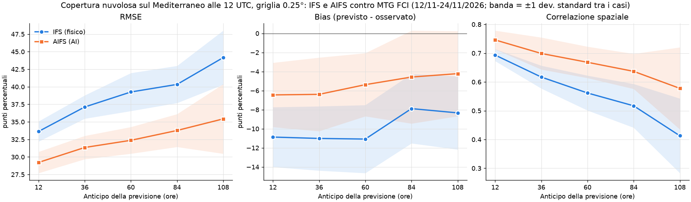
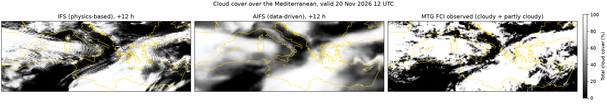

# Cloud cover forecast verification over the Mediterranean: ECMWF AIFS vs IFS against MTG FCI observations

This project compares the **total cloud cover** forecast by ECMWF's data-driven model
(**AIFS Single**) and physics-based model (**IFS**) with cloud observations from the
**MTG-I1 FCI** imager operated by EUMETSAT, over the Mediterranean, for lead times from
12 to 108 hours.



## Key results

Ten 00 UTC forecast runs (12–21 November 2026) verified at 12 UTC on a 0.25° grid
(30–46°N, 6°W–37°E): 49 forecast–observation pairs per model.

- **AIFS has a lower RMSE than IFS in all 49 cases.** Its advantage grows with lead time,
  from 4.4 percentage points (13% of the IFS error) at +12 h to 8.7 points (20%) at +108 h.
- **AIFS keeps the cloud pattern longer:** spatial correlation drops from 0.75 to 0.58
  for AIFS and from 0.69 to 0.41 for IFS.
- **Both models forecast less cloud than observed**, IFS more so (bias −8 to −11 points)
  than AIFS (−4 to −6 points).
- **The result is robust to spatial scale.** Smoother forecasts are favoured by RMSE
  (the "double penalty" problem), and AIFS fields are visibly smoother. After averaging
  all fields to 1°, the relative advantage of AIFS is unchanged (12–20%), so it is not
  only an effect of smoothing.

| Lead time | RMSE IFS (0.25°) | RMSE AIFS (0.25°) | RMSE IFS (1°) | RMSE AIFS (1°) |
|---|---|---|---|---|
| +12 h | 33.6 | 29.2 | 26.3 | 23.2 |
| +36 h | 37.1 | 31.4 | 29.9 | 25.5 |
| +60 h | 39.3 | 32.4 | 32.3 | 26.6 |
| +84 h | 40.3 | 33.8 | 33.3 | 28.2 |
| +108 h | 44.2 | 35.4 | 37.6 | 30.0 |

RMSE in percentage points of cloud cover. Per-case scores: `results/`.



*Example: +12 h forecasts valid on 20 November 2026 at 12 UTC. AIFS reproduces the main
cloud areas with smoother edges than IFS.*

## Data

| Dataset | Provider | Access |
|---|---|---|
| IFS and AIFS Single total cloud cover (`tcc`), 0.25° | ECMWF Open Data (CC BY 4.0) | [`ecmwf-opendata`](https://github.com/ecmwf/ecmwf-opendata), AWS mirror |
| FCI Level 2 Cloud Mask, netCDF (`EO:EUM:DAT:0678`) | EUMETSAT Data Store | [`eumdac`](https://user.eumetsat.int/resources/user-guides/eumetsat-data-access-client-eumdac-guide); free account and MTG data licence required |

## Method

1. **Download** (`src/download_all.py`): forecasts at +12, +36, +60, +84 and +108 h, all
   valid at 12 UTC, and the cloud mask scan starting at 12:00 UTC on each valid day.
   Existing files are skipped, so the script can be re-run after interruptions.
2. **Regridding of the cloud mask** (`src/clm_to_grid.py`): latitude and longitude of each
   FCI pixel are computed from the geostationary projection, and pixels are aggregated into
   0.25° cells centred on the ECMWF grid points (about 90 pixels per cell). Observed cloud
   cover is the percentage of valid pixels flagged as cloudy or partly cloudy
   (`cloud_state` 2 or 3). Cells with fewer than 20 valid pixels are excluded.
3. **Scores** (`src/compute_scores.py`): bias, RMSE, MAE and spatial Pearson correlation
   for each case, aggregated by lead time, plus a case-by-case comparison of the two models.
   `--coarsen 4` repeats the analysis on 1° block averages.

## Pitfalls found along the way

These are the issues a new user is most likely to hit with these datasets.

1. **Same parameter, different units.** In ECMWF Open Data, IFS `tcc` is a fraction (0–1)
   while AIFS `tcc` is a percentage (0–100).
2. **Sign of the FCI x coordinate.** In the FCI Level 2 netCDF files, the `x` coordinate has
   the opposite sign to the PROJ `geos` convention. Without flipping it, the pixels read for
   the Mediterranean come from the mirror region west of Greenwich. This was detected
   quantitatively (`src/check_geolocation.py`): the spatial correlation with IFS and AIFS
   rose from 0.10 to 0.65–0.73 after the fix.
3. **Meaning of `cloud_state` values.** The file carries no `flag_meanings` attribute.
   Values were interpreted from the data: 0 = space, 1 = clear, 2 and 3 = cloudy (partly
   and fully). Counting both 2 and 3 as cloudy matches the models much better (correlation
   0.65–0.73) than counting 3 alone (0.27–0.30). This interpretation should be confirmed
   against the official EUMETSAT product documentation.
4. **Server availability.** The open-data mirror often returned HTTP 503; the download
   client retries automatically, and the download script resumes where it stopped.

## Limitations

- Ten days in one month, one verification time (12 UTC) and one region; consecutive cases
  share the same weather regime and are not independent. Results are indicative.
- Model cloud cover and the satellite cloud mask are not the same quantity (for example,
  thin cirrus and partly cloudy pixels). The absolute bias depends on how "cloudy" is
  defined; the comparison between the two models is fair because both are verified
  against the same observations.
- Forecasts are valid at 12:00 UTC; the corresponding FCI scan covers 12:00–12:10 UTC.

## How to reproduce

```bash
python3 -m venv .venv && source .venv/bin/activate
pip install -r requirements.txt
eumdac auth --interactive            # EUMETSAT account with MTG data licence
python src/download_all.py
python src/clm_to_grid.py
python src/compute_scores.py
python src/compute_scores.py --coarsen 4
python src/plot_first_comparison.py
PYTHONPATH=src python src/check_geolocation.py
```

ECMWF Open Data is a rolling archive: to reproduce the analysis, set `INIT_DATES` in
`src/download_all.py` to recent dates.

## Repository structure

```
src/download_all.py           download of forecasts and cloud masks
src/clm_to_grid.py            FCI cloud mask -> cloud cover on a 0.25° grid
src/compute_scores.py         verification scores and lead-time plots
src/plot_first_comparison.py  maps for a single case
src/check_geolocation.py      quantitative geolocation test
results/                      scores for every forecast-observation pair
figures/                      figures used in this README
```

## Attribution

Forecast data: ECMWF Open Data, licensed under CC BY 4.0.
Contains modified EUMETSAT MTG FCI data (2026).

## Author

Roberto Spina — geologist and computer scientist (PhD in Computer Science).
Code released under the MIT License.
